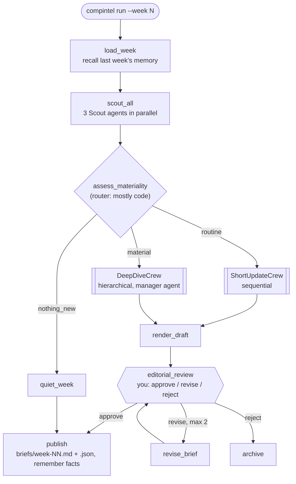

# CompIntel (P3): CrewAI Crews + Flows

A weekly competitive-intelligence brief for **KiranaCloud** (fictional Kolkata B2B SaaS) about three fictional
competitors, built on CrewAI 1.15.33 with Anthropic Claude only.
Full spec: [p3-crewai-competitive-intelligence.md](p3-crewai-competitive-intelligence.md).
Version pins, API verification and every deviation from the spec: [docs/decisions.md](docs/decisions.md).

**Status:** M4 (DeepDiveCrew: hierarchical vs sequential, knowledge, planning, conditional escalation) done.

## Setup

```bash
uv sync                      # creates the project's own .venv (Python 3.12) from uv.lock; crewai needs <3.14
cp .env.example .env         # then put your ANTHROPIC_API_KEY in .env (no OpenAI key, ever)
uv run pytest                # $0: network blocked, no model calls, OPENAI_API_KEY unset
```

`uv run …` always uses the project's `.venv`, never the system Python (3.14, which crewai doesn't support).

## M0: run it yourself

| Command | Cost | What to look at |
|---|---|---|
| `uv run pytest` | $0 | 16 tests, ~2 s. `tests/fakes.py` is the fake model everything is tested with |
| `uv run compintel hello` | ~$0.0005 | One live Haiku call: a single agent classifies a headline into a typed `HeadlineTake` |
| `uv run compintel hello "BahiBook hires a PM for GST e-invoicing"` | ~$0.0005 | Your own headline: watch `impact_on_us` change |
| `uv run compintel hello --verbose` | ~$0.0005 | crewai's own trace of the agent run |
| `uv run compintel hello --final` | ~$0.01 | Same call on Sonnet 5.5 (`MODEL_FINAL`) |
| `uv run compintel costs` | $0 | Spend per model and agent from `runs/costs.jsonl`, against the $12 cap |

### What happens when you run `compintel hello`

1. `apply_env()` exports `MODEL=anthropic/claude-haiku-5-5` and turns crewai telemetry/tracing off,
   **before** crewai is imported (crewai reads these on import).
2. `listeners.install()` registers `CostListener` on crewai's **event bus**, and `hooks.install()` registers
   `budget_gate` as an **`@on(PRE_MODEL_CALL)` hook**.
3. `Agent(...).kickoff(prompt, response_format=HeadlineTake)` runs **one agent with no crew** (a "LiteAgent" run).
4. Before the API request, `budget_gate` runs. If the ledger is at the $12 cap it raises `HookAborted`, and the call never happens.
5. The native Anthropic provider sends the request with the `HeadlineTake` JSON schema and parses the reply
   into the Pydantic object (`out.pydantic`).
6. The provider emits `LLMCallCompletedEvent` with token usage. `CostListener` prices it and appends a row to
   `runs/costs.jsonl` (on a background thread, so the CLI calls `crewai_event_bus.flush()` before printing).

### Where each M0 concept lives

| Concept | Code |
|---|---|
| Native Anthropic provider, explicit LLM / limits / embedder (no OpenAI defaults) | [src/compintel/config.py](src/compintel/config.py) |
| `Agent.kickoff` + `response_format` (agent without a crew, typed output) | [src/compintel/hello.py](src/compintel/hello.py) |
| Event bus + `BaseEventListener` → cost ledger | [src/compintel/listeners.py](src/compintel/listeners.py), [src/compintel/cost.py](src/compintel/cost.py) |
| `@on` hook + `HookAborted` → spend cap | [src/compintel/hooks.py](src/compintel/hooks.py) |
| Custom LLM interface (`BaseLLM`) → `ScriptedLLM`; `FakeEmbedder` | [tests/fakes.py](tests/fakes.py) |
| $0 guards: no network, no OpenAI key, hooks/handlers cleared per test | [tests/conftest.py](tests/conftest.py), [tests/test_no_openai.py](tests/test_no_openai.py) |

## M1: the mock world ($0)

The agents never touch the real internet. Three weeks of fictional market signals are generated from one
storyline file ([src/compintel/world/story.py](src/compintel/world/story.py)) and served locally.

| Command | What to look at |
|---|---|
| `uv run python scripts/gen_world.py` | Writes `data/` and `knowledge/`. Deterministic: rerun it and nothing changes |
| `uv run python scripts/serve_fakeweb.py --verbose` | Fake competitor websites on `127.0.0.1:8765`, logging each request. Keep it running from M2 on |
| `curl http://127.0.0.1:8765/week-2/stocksathi/pricing.html` | Week 2's price cut (`₹699`, old price struck through). Try weeks 1 and 3 |
| `curl http://127.0.0.1:8765/week-2/shelfmitra/careers.html` | The 15 Kolkata sales roles that appear in week 2 |
| `sqlite3 data/news.sqlite "select week, company, source_credibility, title from articles"` | News with credibility scores. The week-3 rumor is 0.2 |
| `cat data/ground_truth/week-3.json` | What a correct week-3 brief must contain, and must not claim |

### What the agents will read (from M2 on)

| Source | Served by | Per week |
|---|---|---|
| Pricing, changelog, careers pages | `scripts/serve_fakeweb.py` at `/week-N/<stocksathi\|shelfmitra\|bahibook>/<page>.html` | Snapshot of the site that week (changelog is cumulative) |
| News articles + `source_credibility` | `data/news.sqlite` (NewsSearchTool, M2) | 2–4 articles |
| Funding rounds, app-rating trend | MCP server `scripts/mcp_market_signals.py` (stdio) | Only data public by `MARKET_AS_OF_WEEK` |
| KiranaCloud pricing, 2027 roadmap, customer profile | `knowledge/*.md` (knowledge sources, M4) | Static |

Two leak guards keep a week-1 run from seeing week 2: the web server refuses directory listings (an agent can
only open URLs it's given), and the MCP server filters by `MARKET_AS_OF_WEEK`, which the run sets.

The storyline, and what each week should produce:

| Week | StockSathi | ShelfMitra | BahiBook | Route |
|---|---|---|---|---|
| 1 | Dark mode, faster sync | Purchase-order approvals | Rounding bug fix | routine |
| 2 | **Pro ₹999 → ₹699 (−30%)**, **UPI Udhaar** credit launch | **₹200 cr Series B**, **15 sales roles in Kolkata** | A5 layout fix | **material** |
| 3 | Rating 4.3 → 3.9; *rumor* of acquisition (credibility 0.2) | Kolkata office opens | **PM, GST e-invoicing** job post | routine, but surface BahiBook + discount the rumor |

The knowledge docs deliberately overlap: UPI credit and GST e-invoicing are both on KiranaCloud's 2027 roadmap.

## M2: tools and scouts

Keep `uv run python scripts/serve_fakeweb.py --verbose` running in another terminal and watch the scouts' requests.

| Command | Cost | What to look at |
|---|---|---|
| `uv run compintel scout --week 2` | ~$0.009, ~35 s | 3 scouts in parallel; signal table; ✓/✗ against `data/ground_truth/week-2.json` |
| `uv run compintel scout --week 3` | ~$0.006 | The subtle week: BahiBook's GST e-invoicing PM surfaced, the acquisition rumor filed as `rumor` (credibility 0.2) |
| `uv run compintel scout --week 2 --via crew` | ~$0.006, ~67 s | Same scout as a one-task Crew via `kickoff_for_each`: sequential, and it loses the MCP tools (see below) |
| `uv run compintel scout --week 2 --verbose` | ~$0.009 | crewai's own trace: every tool call and result |
| `uv run python scripts/mcp_adapter_demo.py` | $0 | MCP via `MCPServerAdapter` vs the `mcps` DSL, and what `Agent.copy()` does to each |

Reports are saved to `runs/scout/week-N.<via>.json`.

### What one scout does

1. `make_scout(week)` builds an `Agent` with 4 tools plus `mcps=[MCPServerStdio("market-signals", env={"MARKET_AS_OF_WEEK": week})]`.
   It refuses to build unless the `url_allowlist` hook is installed (see below).
2. `agent.kickoff_async(prompt, response_format=SignalReport)` starts the agent loop. crewai launches the MCP server as a
   subprocess and adds its tools as `market_signals_funding_rounds` / `market_signals_app_rating_trend`.
3. **Loop:** Haiku asks for tools (native tool calling: Anthropic `tool_use` blocks), crewai runs them and feeds the
   results back, and so on until Haiku answers. A scout typically uses 2–3 LLM calls: one batch of ~6 tool calls, then the answer.
4. **Typed result:** crewai first tries `SignalReport.model_validate_json(final_answer)`. If that fails it makes one more
   LLM call (the Converter). The prompt carries the schema so the first attempt succeeds.
5. `scout_all(week)` runs three of these under `asyncio.gather`, so they wait on the API concurrently.

| Tool | Kind | Why |
|---|---|---|
| `pricing_parse(company, week)` | `@tool` | Prices parsed in code (exact), with the week-over-week change computed |
| `changelog_diff(company, week)` | `@tool` | Only entries added this week |
| `news_search(company, week, min_credibility)` | `BaseTool` + `args_schema` + `cache_function` | Typed args the LLM sees; caches only non-empty results |
| `read_website_content(website_url)` | built-in `ScrapeWebsiteTool` | Careers pages; the LLM picks the URL, so the hook polices it |
| `market_signals_*` | MCP over stdio (`mcps` DSL) | Funding and ratings, only up to the run's week |

### The URL allowlist (decided with you at M2 start)

crewai-tools' scraper has its own SSRF guard, which blocks `127.0.0.1` and therefore our fake web. Its only off-switch,
`CREWAI_TOOLS_ALLOW_UNSAFE_PATHS`, is process-wide. compintel sets it inside its own runs only (never in your shell),
and the `@on(PRE_TOOL_CALL, tools=["read_website_content"])` hook `url_allowlist` becomes the network policy:
`http(s)://127.0.0.1:8765` only, with no `user@host` tricks. A blocked call doesn't end the run: the agent receives
"Tool execution blocked by hook" as the tool result and carries on. (A `PRE_MODEL_CALL` abort, like the budget
gate, ends the run.)

### Agents vs `kickoff_for_each` (live, week 2)

| | `Agent.kickoff_async` × 3 + `gather` (kept) | one-task Crew + `kickoff_for_each` |
|---|---|---|
| Wall time | 35 s | 67 s: `kickoff_for_each` runs inputs sequentially |
| LLM calls / cost | 10 / $0.0086 | 8 / $0.0064 (cheaper only because MCP calls were missing) |
| Material signals found | **4/4** | 3/4: missed ShelfMitra's Series B |
| Why | | `Crew.kickoff_for_each` copies the crew per input, and `Agent.copy()` drops `mcps` (crewai 1.15.33): no market tools |
| Code | Agent + prompt | Agent + Task + Crew + `{placeholders}` |

## M3: ShortUpdateCrew (the routine-week brief)

| Command | Cost | What to look at |
|---|---|---|
| `uv run compintel brief --week 1` | ~$0.007, ~45 s | Reads `runs/scout/week-1.agents.json` (run `compintel scout --week 1` first). Prints the brief and every guardrail verdict |
| `uv run compintel brief --week 3` | ~$0.006 | The rumor week: watch `low_credibility_only_discounted` reject a draft that uses the 0.2-credibility rumor |
| `uv run compintel brief --week 1 --final` | ~$0.05 | Brief Writer on Sonnet 5.5, analyst stays on Haiku |
| `uv run python scripts/backstory_experiment.py` | ~$0.003 | Same task with an 18-word vs 193-word backstory: tokens, cost, judgement |

Outputs: `briefs/drafts/week-NN.json` (the approved Brief) and `briefs/drafts/week-NN.md` (rendered).

### The crew is JSON

```
src/compintel/crews/short_update/
├── crew.jsonc               # process, tasks, guardrails, callbacks, output_file
├── agents/market_analyst.jsonc
├── agents/brief_writer.jsonc
├── crew_refs.py             # the only Python the JSON may reference ({"python": "crew_refs.X"})
└── __init__.py              # load_crew() + run(): supplies inputs, nothing about the crew's shape
```

crewai's JSON loader only imports `{"python": ...}` references from files under the crew file's folder, so
`crew_refs.py` re-exports exactly what the JSON may use (models, guardrails, callbacks, the LLMs). Agent LLMs
are `{"python": "crew_refs.analyst"}`, built on access by `compintel/llms.py` → `config.make_llm`, so models and
token budgets still live in Python.

### What one run does (3 tasks, sequential)

1. **`classify_signals`** (Market Analyst, no tools): this week's signals → `ThreatAssessments` (one per
   competitor). With no tools, crewai sends the schema natively: one LLM call.
2. **`write_short_brief`** (Brief Writer): `context=[classify_signals]` + the signals → a `Brief`, then three
   guardrails (below). On a failure, crewai sends the guardrail's message back to the writer and re-runs the task,
   up to `guardrail_max_retries: 2`. The task `callback` saves the approved Brief to `briefs/drafts/week-NN.json`.
3. **`render_draft`** (Brief Writer): calls `render_brief(week)`, a `result_as_answer` tool. Its markdown becomes
   the task output verbatim (no LLM rewrite), and `output_file` saves it.

Typical cost: 4 LLM calls when the first draft passes, plus 2 per guardrail retry.

### Guardrails, in the order they run

| # | Guardrail | Kind | Checks |
|---|---|---|---|
| 1 | "Judge only from the brief's own text…" | string (LLM) | A claim the brief itself calls rumored/unverified is never stated as fact |
| 2 | `every_claim_cites_signal` | function | Every TL;DR item and discounted claim cites an id; ids are real (this run's signals, registered by a `before_kickoff` callback) |
| 3 | `low_credibility_only_discounted` | function | Signals below 0.5 credibility appear in `discounted_claims` and nowhere else |

Order matters. crewai retries each guardrail until it passes, and only that guardrail re-checks the retry. So the
deterministic checks go last, where they get the final word.

Why credibility is a function and not the spec's string guardrail: an LLM guardrail sees only the task output,
and the credibility scores are in the inputs. Live, the string version failed a week-1 brief that had *no*
low-credibility signal, twice, and its feedback pushed the writer to discount a 0.9-credibility fact.

### Backstory length (live, week-2 signals, classify task)

| Backstory | Input tokens/call | First call | Cached repeat | Threat levels vs ground truth |
|---|---|---|---|---|
| 18 words (the JSON one) | 4,250 | $0.00092 | $0.00044 | 2/3 |
| 193 words | 4,593 (+8%) | $0.00102 (+11%) | $0.00046 | 2/3, identical levels |

The long backstory is paid for on every uncached call and changed nothing. Prompt caching hides most of the
cost on repeats. Both variants under-rate ShelfMitra in week 2. Week 2 goes to the deep dive in M4, not this crew.

## M4: DeepDiveCrew (the material-week brief)

| Command | Cost | What to look at |
|---|---|---|
| `uv run compintel deepdive --week 2` | ~$0.03, ~3 min | Hierarchical, Head of Strategy as manager. Prints the brief, escalation memo, guardrails, delegations, a ground-truth check |
| `uv run compintel deepdive --week 2 --variant sequential` | ~$0.07, ~6 min | Each task on its specialist; the three analyses in parallel |
| `uv run compintel deepdive --week 2 --variant manager_llm` | ~$0.03 | crewai's generic manager built from `manager_llm` |
| `uv run python scripts/process_comparison.py --variant <v>` then `--report` | ~$0.03-0.07 each | Writes [docs/process-comparison.md](docs/process-comparison.md) |

Needs `runs/scout/week-2.agents.json` and the fake web server (the analysts' tools). The first live run
downloads the ONNX embedding model (~80 MB).

### The crew is classic @CrewBase + YAML

```
src/compintel/crews/deep_dive/
├── config/agents.yaml     # role/goal/backstory for 5 specialists + the Head of Strategy
├── config/tasks.yaml      # descriptions, intended agent, context, async
└── deep_dive_crew.py      # @CrewBase: @agent, @task, @crew, @before_kickoff, @after_kickoff;
                           # LLMs, tools, knowledge, planning, guardrails, condition, the 3 variants
```

### What one run does

1. **`@before_kickoff`** adds the schemas and previous brief to the inputs and registers the signals for the guardrails.
2. **Crew planning** (`planning=True`, `planning_llm` = Haiku): one planner call writes a step plan into every task.
3. **Three analyses**: `pricing_analysis`, `product_overlap`, `market_threats` (`async_execution`; in parallel in
   `sequential` only). `market_threats` must pass `threat_levels_consistent` (each level matches its evidence).
4. **`synthesis`** (Strategist, `PlanningConfig` medium) combines them into a typed `Synthesis`.
5. **`escalation_memo`** is a `ConditionalTask`: `any_high_threat(synthesis)` decides whether it runs (`markdown=True`).
6. **`write_brief`**: a `Brief` behind 4 guardrails (LLM rule first, then citations, credibility, ≤600 words).
7. **`@after_kickoff`** saves `briefs/drafts/week-NN.json/.md` and the crew's `token_usage` to `runs/crew_usage.jsonl`.

Knowledge: the crew gets all four KiranaCloud docs (3 markdown + the battlecard PDF); the Pricing and Product
Analysts also get their one doc at agent level. Each task with knowledge costs one extra LLM call: crewai rewrites
the prompt into a search query before retrieving.

### The process comparison, in one paragraph

On Haiku 5.5 **neither manager ever delegated**, in three live hierarchical runs, although both were offered the
delegation tools on every call. So "hierarchical" ran as one generalist with all the context: $0.026-0.033 and
~3 min, against $0.067 and ~6 min for `sequential`, where the specialists' agent planning (`PlanningConfig`) made
most of the calls. All three cited 4/4 material signals and led with Kolkata; `sequential` and `manager_llm` got
all three threat levels right. Full table and discussion: [docs/process-comparison.md](docs/process-comparison.md).

## Later milestones' commands

| Command | Cost | Milestone |
|---|---|---|
| `uv run compintel run --week 1\|2\|3` | ~$0.3–0.6 / week | M5 |
| `uv run compintel chat` | cents | M7 |

## How one weekly run flows, end to end

The one idea to hold onto: **a Flow is the control layer** (plain Python decides *when* and *which*), and
**Crews/Agents are the autonomy layer** (LLMs decide *how*). The Flow owns state and routing and calls a crew
only for the fuzzy parts.



1. **Mock world (inputs, $0).** `scripts/gen_world.py` writes 3 weeks of deterministic fake data: competitor
   pricing/changelog/careers HTML (served at `127.0.0.1:8765` so CrewAI's real scraping tool works), a news
   SQLite DB, and an MCP server with funding + app-rating data. Week 1 is boring, week 2 has material news
   (price cut, Series B, Kolkata hiring), week 3 has one subtle signal and one rumor to discount.
2. **`load_week`** (`@start`). Flow state (`CIState`) is restored from last week's run with `@persist` +
   `restore_from_state_id`, so the flow "remembers" last week's threats. It also recalls `/competitor/*` memories.
3. **`scout_all`**. One Scout agent per competitor runs **without a crew** (`Agent.kickoff_async`, all 3 concurrently).
   Each uses tools (scrape, news search, changelog diff, pricing parse, MCP) and must return a typed
   `SignalReport` (`response_format=`). Each scout can only see its own competitor's memory scope.
4. **`assess_materiality`** (`@router`). A deterministic score over the signals (impact × credibility × novelty)
   picks a label: `nothing_new`, `routine` or `material`. An LLM is called only to break a tie.
   The label *is* the route: listeners subscribed to that string run next.
5. **The crew that writes the draft.**
   - *routine* → **ShortUpdateCrew**: 2 agents, sequential, defined as JSON (`crew.jsonc`). It classifies threats,
     then writes a short `Brief`.
   - *material* → **DeepDiveCrew**: hierarchical. A "Head of Strategy" manager agent delegates pricing, product
     and market analyses (run in parallel), then synthesis. An escalation memo runs **only if** a threat is high
     (`ConditionalTask`), then the final `Brief`. It reads KiranaCloud's own docs as **knowledge**, and it
     checkpoints after each task, so a crash resumes without redoing finished tasks.
   - Every brief passes **guardrails** before it's accepted: every claim cites a signal ID (code check), no
     low-credibility claim stated as fact (LLM-checked rule), and length. A failure auto-retries the task.
6. **`editorial_review`** (`@human_feedback`). The flow pauses and shows *you* the draft. You type free text.
   An LLM maps it to `approve` / `revise` / `reject` (`emit=`), and with `learn=True` your feedback is
   distilled into a lesson stored in memory, so next week's draft is pre-reviewed against it.
   `revise` loops through a revision crew, at most 2 times.
7. **`publish`**. Writes `briefs/week-NN.md` + `.json`, saves key facts to memory (`/brief/week-NN`), and records
   the flow state id so next week can fork from it.
8. **Cross-cutting, always on.** `@on` hooks enforce policy (scrapes may only hit `127.0.0.1:8765`, the spend cap
   aborts runs, secrets are redacted). An event listener records every LLM call's tokens to the cost ledger
   and drives a live console.

After a few weeks have run, **`compintel chat`** (a conversational Flow) answers questions such as "What did
ShelfMitra do in Kolkata and when?" from memory and past briefs.

## Milestones

| | What lands | Est. cost |
|---|---|---|
| M0 | Config (Anthropic-only), ScriptedLLM test fake, cost ledger listener, live hello | $0.05 |
| M1 | Mock world generator, fake web server, MCP server, ground truth | $0 |
| M2 | Tools, URL-allowlist hook, Scout fan-out | $0.80 |
| M3 | ShortUpdateCrew (JSON-first, guardrails) | $0.80 |
| M4 | DeepDiveCrew (hierarchical, knowledge, planning) + process comparison | $2.00 |
| M5 | The Flow, persistence, checkpointing, replay | $1.20 |
| M6 | Human feedback (blocking, async, learn) | $1.00 |
| M7 | Unified memory + Ask the Analyst chat | $1.20 |
| M8 | Full hooks, tracing, evals, `crewai test/train` | $3.00 |
| M9 | Polish & retrospective | $0.30 |

Budget cap $12, enforced in code from M0.

## Resetting local state

`crewai reset-memories -a` clears CrewAI's memory/knowledge stores. `rm -rf runs/` clears flow persistence,
checkpoints and the cost ledger (don't do this if you want to keep the spend history).
