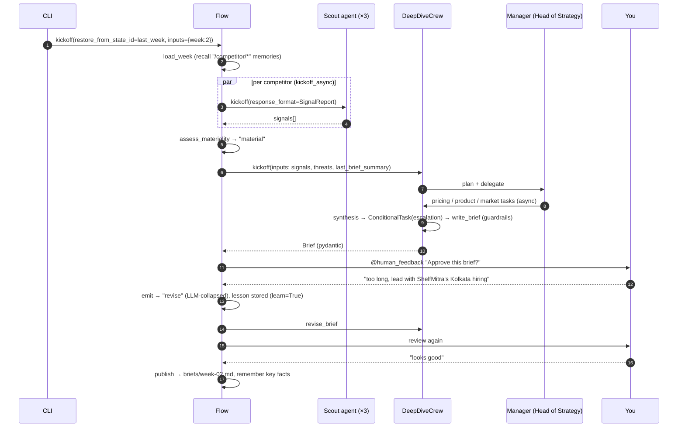
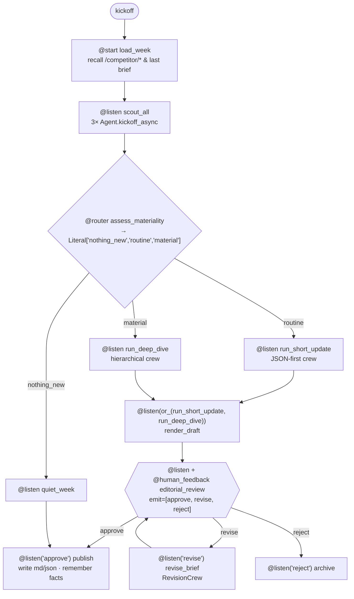

# P3 — CrewAI: Competitive Intelligence Brief

> **Detailed build spec — Project 3 of 7** in the agentic frameworks lab (see `agentic-frameworks-build-plan.md`).
> **Framework:** **CrewAI 1.15.x** (Crews + Flows), `crewai[anthropic]` native provider (no LiteLLM), `crewai-tools`
> **Model provider:** Anthropic Claude via your API key · **local embeddings** for memory & knowledge
> **Budget cap:** **$12** (enforced in code) · **Estimated effort:** 1.5 weeks part-time
> Supersedes Section 4 of the master plan.

---

## Table of contents
0. [Rules for Claude Code](#0-rules-for-claude-code)
1. [What you're building & why](#1-what-youre-building--why)
2. [CrewAI primer — concepts this project must cover](#2-crewai-primer)
3. [System architecture](#3-system-architecture)
4. [Domain & mock world (3 weeks of market signals)](#4-domain--mock-world)
5. [Data models](#5-data-models)
6. [Tools: custom, built-in, MCP](#6-tools-custom-built-in-mcp)
7. [Agents](#7-agents)
8. [Crews](#8-crews)
9. [The Flow (orchestrator)](#9-the-flow-orchestrator)
10. [Human feedback](#10-human-feedback)
11. [Memory & knowledge](#11-memory--knowledge)
12. [Hooks, guardrails & event listeners](#12-hooks-guardrails--event-listeners)
13. [Checkpointing, persistence, replay & forking](#13-checkpointing-persistence-replay--forking)
14. [Conversational flow: "Ask the Analyst"](#14-conversational-flow-ask-the-analyst)
15. [Streaming & observability](#15-streaming--observability)
16. [Testing strategy ($0 tests)](#16-testing-strategy-0-tests)
17. [Evals & training](#17-evals--training)
18. [Repository layout](#18-repository-layout)
19. [Configuration](#19-configuration)
20. [Milestones](#20-milestones)
21. [Budget plan](#21-budget-plan)
22. [Stretch goals](#22-stretch-goals)
23. [Learning journal](#23-learning-journal)
24. [Feature coverage matrix](#24-feature-coverage-matrix)
25. [Kickoff prompts](#25-kickoff-prompts)
26. [References](#26-references)

---

## 0. Rules for Claude Code

In addition to Section 0 of the master plan:

1. **One milestone at a time** (§20). End each with: what was built, how to run it, which CrewAI concepts were used and where, spend so far. Then **stop**.
2. **Verify before you write.** CrewAI ships very frequently (1.15.x patch releases weekly) and has renamed things recently (`reasoning=True` → `PlanningConfig`; legacy hook decorators → `@on`; `inputs.id` → `restore_from_state_id`; unified `Memory` replaced short/long/entity memory; JSON-first crew layout). Before each milestone:
   - Read `https://docs.crewai.com/llms.txt` and fetch the relevant pages (append `.md` to any docs URL for raw markdown).
   - Optionally install CrewAI's official coding-agent skills (`crewaiinc/skills`, see "Skills" / "Build with AI" docs) into Claude Code.
   - Cross-check against the installed source (`.venv/.../crewai/`). List deviations from this spec **before** coding.
3. **Anthropic-only environment.** Several CrewAI defaults silently assume OpenAI. You must explicitly configure **every** one of these (and grep for others):
   - Agent / Crew LLMs → `anthropic/...`
   - `Crew(planning=True)` → set `planning_llm`
   - Hierarchical process → set `manager_llm` or a custom `manager_agent`
   - Unified `Memory` → set its `llm` **and** a **local embedder**
   - Knowledge sources → set a local `embedder`
   - `@human_feedback(emit=...)` → set `llm=`
   - LLM-string guardrails, `crewai test`, `crewai train` → check what model they use; configure or document
   - A run with `OPENAI_API_KEY` **unset** must still work — add a test that asserts this.
4. **Native provider, no LiteLLM.** Install `crewai[anthropic]`; never `crewai[litellm]`. Model strings use the `anthropic/` prefix.
5. **Use the native feature.** Don't hand-roll routing, persistence, checkpointing, memory, guardrail retries, HITL, hooks or event plumbing. If you think you must, ask first.
6. **Explain every primitive** with a one-line comment: why a router here, why hierarchical there, why this guardrail is a function vs a string, why a scope vs a slice.
7. **$0 tests** (§16): a scripted fake LLM implemented via CrewAI's custom-LLM interface. Live calls only in `scripts/` and `evals/` when the developer runs them.
8. **Budget**: CrewAI is token-hungry (role/goal/backstory prompts, ReAct loops, manager delegation). Set `max_iter`, `max_rpm`, `max_execution_time`, `max_tokens` on every agent; read `usage_metrics` after every run into the cost ledger.
9. Don't add dependencies outside §19.2 without asking.

---

## 1. What you're building & why

### 1.1 The product
**CompIntel** produces a **weekly competitive-intelligence brief** for **KiranaCloud**, a (fictional) Kolkata-based B2B SaaS that sells inventory + billing software to kirana stores. It watches three (fictional) competitors across news, pricing pages, product changelogs, job postings, app-store review summaries and funding data, then:

1. **Scouts** each competitor in parallel and extracts structured *signals*.
2. **Assesses materiality** — nothing new / routine / material — and routes accordingly.
3. Runs a **short-update crew** (routine) or a **deep-dive crew** (material, hierarchical with a Head-of-Strategy manager).
4. Puts the draft in front of **you** for approve / revise / reject (with a learning loop that makes future drafts better).
5. **Publishes** `briefs/week-NN.md` + `.json`, and **remembers** what it learned so next week's brief can say "since last week…".
6. Lets you **chat** with an "Ask the Analyst" conversational flow over everything it knows.

It runs over **3 simulated weeks** of data, so you see memory, persistence and week-over-week reasoning actually matter.

### 1.2 Why this project for CrewAI

| Need in the domain | CrewAI feature |
|---|---|
| A team of specialists with clear roles | Agents (role/goal/backstory), Crews, Tasks with `context` |
| Some weeks need depth, others don't | Flow `@router` → different crews |
| Deep dive needs a coordinator | Hierarchical process + custom manager agent, delegation |
| Independent research in parallel | `async_execution` tasks, `kickoff_for_each`, async flows |
| Escalate only when threat is high | `ConditionalTask` |
| Editorial sign-off | `@human_feedback` with `emit` routing, `learn=True` |
| "Since last week…" | Unified `Memory` (scopes/slices), Flow `@persist`, fork via `restore_from_state_id` |
| Company context (our pricing, roadmap) | Knowledge sources |
| Don't publish speculation as fact | Task guardrails (function + LLM-string) |
| Never touch the real internet / unsafe tools | `@on` execution hooks (`PRE_TOOL_CALL` policy) |
| Long runs fail midway | Checkpointing (+ TUI fork/edit), `crewai replay` |
| Plan before acting | `PlanningConfig` (agent), `Crew(planning=True)` |
| Structured, typed outputs | `output_pydantic`, `response_format` on `Agent.kickoff` |

### 1.3 Non-goals
- No real web scraping / paid search APIs — a **local fake web server** serves the mock world (so built-in scraping tools work for real, at $0).
- No CrewAI AMP (enterprise platform) dependency — optional comparisons only.
- No frontend beyond terminal (AG-UI/CopilotKit is a stretch).

### 1.4 What "done" looks like
- `uv run compintel run --week 1|2|3` produces correct routing per week (§4.4 ground truth): week1 → routine, week2 → **material**, week3 → routine (with one subtle signal caught, one rumor discounted).
- Week-3 brief explicitly references week-1/2 developments via memory.
- HITL revise loop works; `learn=True` measurably changes the second draft (lesson visible in memory).
- Kill mid-deep-dive → resume from checkpoint skips completed tasks.
- `pytest` < 60 s, 0 network, 0 model calls; passes with `OPENAI_API_KEY` unset.
- Eval: material-signal recall = 100% on week 2; brief claims all cite a signal ID; total spend ≤ $12.

---

## 2. CrewAI primer

Claude Code should explain each to the developer when first used.

| Concept | One-liner | Where |
|---|---|---|
| **Agent** | LLM + role/goal/backstory + tools + limits (`max_iter`, `max_rpm`, `max_execution_time`), optional `planning_config`, `allow_delegation` | §7 |
| **Agent.kickoff** | Run a single agent *without* a crew; supports `response_format=PydanticModel` | Scout (§8.1) |
| **Task** | `description`, `expected_output`, `agent`, `context=[tasks]`, `async_execution`, `output_pydantic/json`, `output_file`, `guardrail(s)`, `human_input`, `callback`, `markdown` | §8 |
| **ConditionalTask** | Task that runs only if `condition(prev_output)` is true | Deep dive escalation |
| **Crew** | Agents + tasks + `process` (sequential / hierarchical), `memory`, `knowledge_sources`, `planning`, `checkpoint`, `stream`, `embedder` | §8 |
| **Hierarchical process** | A manager (LLM or custom agent) plans, delegates and validates | Deep dive |
| **Crew layouts** | Classic `@CrewBase` + `agents.yaml`/`tasks.yaml`, or **JSON-first** `crew.jsonc` + `agents/*.jsonc` loaded with `load_crew` | Both used (§8) |
| **Flow** | Event-driven orchestrator: `@start`, `@listen`, `@router`, `or_`, `and_`, typed `Flow[State]` | §9 |
| **@persist** | Auto-save flow state (SQLite default); resume by `inputs={"id":…}`, **fork** by `restore_from_state_id` | Week-over-week |
| **@human_feedback** | Pause a flow method for human review; `emit=[…]` turns feedback into routes via an LLM; `learn=True` distills lessons into memory; async `provider` for non-blocking | §10 |
| **Memory (unified)** | One `Memory` class: LLM-inferred scopes, composite scoring (similarity + recency + importance), scopes/slices, `remember/recall/extract_memories`, consolidation | §11 |
| **Knowledge** | Static reference docs (our strategy, pricing) embedded for retrieval | §11 |
| **Tools** | `BaseTool` subclass, `@tool` decorator, `cache_function`, `result_as_answer`, built-in `crewai-tools`, **MCP** via the `mcps` field (DSL) or `MCPServerAdapter` | §6 |
| **Guardrails** | Function guardrail `(ok, value_or_error)` → auto-retry; string guardrail = LLM-checked rule | §12 |
| **Execution hooks** | `@on(InterceptionPoint.X, agents=, tools=)` — observe / mutate / replace / `HookAborted` at execution start/input/output/end, pre/post model, pre/post tool, pre/post step | §12 |
| **Event listeners** | `BaseEventListener` on `crewai_event_bus` — LLM, tool, task, flow, memory events | Cost ledger, live console |
| **Planning** | `PlanningConfig` on agents (plan→execute→observe→replan); `Crew(planning=True, planning_llm=…)` | Strategist, deep dive |
| **Checkpointing** | `checkpoint=True/CheckpointConfig` on Crew/Flow/Agent; JSON or SQLite provider; resume / fork; `crewai checkpoint` TUI | §13 |
| **Replay** | `crewai replay -t <task_id>` re-runs from a task of the latest kickoff | §13 |
| **kickoff_for_each / async** | Run a crew per input; `kickoff_async`, async tasks, async flows | Scout fan-out |
| **Streaming** | `stream = True` on Flow/Crew → iterate chunks; `.result` at end | §15 |
| **usage_metrics** | `flow.usage_metrics` = full token rollup across all crews/LLM calls in a flow run (≠ `kickoff().token_usage`) | Cost ledger |
| **Conversational Flows** | Multi-turn chat flows (`handle_turn`), message history, intent routing | §14 |
| **CLI** | `crewai create flow|crew`, `crewai run`, `crewai flow plot`, `crewai test`, `crewai train`, `crewai replay`, `crewai checkpoint`, `crewai reset-memories` | Throughout |

### 2.1 Mental model
> **Crews = autonomy** (agents decide how; you define *who* and *what*). **Flows = control** (you decide *when* and *which*). The idiomatic production shape is *a Flow that owns state and routing, calling Crews (or single Agents) for the fuzzy parts.* Compare with P2 (events everywhere) and P4 (explicit graph).

### 2.2 Gotchas to watch
- OpenAI defaults hiding in planning LLM, memory embedder/LLM, HITL `emit` LLM, `crewai test` judge (docs say OpenAI-only for now) — see Rule 3.
- `flow.usage_metrics` vs `kickoff().token_usage` — only the former is the full flow total.
- `@start()` methods can't self-loop; put `@human_feedback` revision loops on `@listen` methods.
- Declare router labels (`Literal[...]` return or `emit=[...]`) or `flow.plot()` can't draw branches.
- Checkpoint restore rebuilds from the file: lambdas/closures/bound-method callbacks and callable guardrails are **not** restored; module-level function callbacks need `CREWAI_DESERIALIZE_CALLBACKS=1` (trusted files only).
- Hooks that raise anything other than `HookAborted` are **swallowed** (fail-open) — don't rely on `ValueError` to stop a run. Clear global hooks between tests.
- Memory dimension mismatch when switching embedders → `crewai reset-memories` / delete local store.
- `@human_feedback` async resume restores Pydantic outputs as dicts.

---

## 3. System architecture

### 3.1 Component view

```mermaid
flowchart TB
    subgraph Inputs["Mock world (local, $0)"]
      FW[Fake web server<br/>localhost:8765/week-N/...<br/>pricing, changelogs, jobs]
      NF[(news.sqlite<br/>articles by week)]
      MCPS[MCP server: market-signals<br/>funding, app ratings]
      KN[/knowledge/: KiranaCloud<br/>strategy, pricing, roadmap/]
    end

    subgraph Flow["CompetitiveIntelFlow (Flow[CIState], @persist)"]
      L[load_week] --> SC[scout_all<br/>Agent.kickoff × competitors]
      SC --> R{assess_materiality<br/>@router}
      R -->|nothing_new| NN[note_quiet_week]
      R -->|routine| SU[[ShortUpdateCrew<br/>sequential · JSON-first]]
      R -->|material| DD[[DeepDiveCrew<br/>hierarchical · custom manager]]
      SU & DD --> HF{{editorial_review<br/>@human_feedback emit}}
      HF -->|revise| RV[revise_brief] --> HF
      HF -->|approve| PUB[publish + remember]
      HF -->|reject| REJ[archive_rejected]
    end

    subgraph X["Cross-cutting"]
      MEM[(Unified Memory<br/>LanceDB, local embedder)]
      HK[@on hooks<br/>policy, redaction, budget]
      EL[Event listener<br/>cost ledger, live console]
      CK[(Checkpoints<br/>SQLite provider)]
      PS[(Flow persistence<br/>SQLite)]
    end

    SC --> FW & NF & MCPS
    DD --> KN
    Flow -.-> MEM & HK & EL & CK & PS
    CHAT[AskAnalystFlow<br/>conversational] --> MEM
    PUB --> OUT[/briefs/week-NN.md + .json/]
```

### 3.2 One week's run (material case)



---

## 4. Domain & mock world

### 4.1 Companies (all fictional)
| Company | HQ | Positioning | Role |
|---|---|---|---|
| **KiranaCloud** | Kolkata | Inventory + GST billing for kirana stores, ₹799/mo | **Us** (knowledge base) |
| **StockSathi** | Bengaluru | Price-aggressive, mobile-first | Competitor |
| **ShelfMitra** | Mumbai | Well-funded, enterprise-leaning, expanding east | Competitor |
| **BahiBook** | Pune | Niche, accounting-first, slow mover | Competitor |

> Claude Code: double-check these names don't collide with notable real companies; if they do, rename consistently across the mock data.

### 4.2 Signal sources per competitor per week
| Source | Served via | Tool |
|---|---|---|
| Pricing page (HTML) | Fake web `/week-N/<co>/pricing.html` | `ScrapeWebsiteTool` (built-in) |
| Product changelog (HTML) | Fake web `/week-N/<co>/changelog.html` | `ScrapeWebsiteTool` + custom `ChangelogDiffTool` |
| Careers page (HTML) | Fake web `/week-N/<co>/careers.html` | `ScrapeWebsiteTool` |
| News articles (with `source_credibility`) | `news.sqlite` | custom `NewsSearchTool` (`BaseTool`, cached) |
| Funding rounds, app-rating trend | MCP server `market-signals` | via `mcps` DSL |

### 4.3 The 3-week storyline
| Week | StockSathi | ShelfMitra | BahiBook | Expected route |
|---|---|---|---|---|
| **1** (baseline) | Normal blog posts | Normal | Minor bug fixes | **routine** |
| **2** (material) | **Cuts Pro plan 30%** (₹999→₹699, undercuts us) + launches "UPI Udhaar" credit feature | **Series B ₹200 cr** (MCP) + **15 sales roles in Kolkata** (careers) — direct threat to our home market | Bug fixes | **material** |
| **3** (subtle) | Pricing unchanged; review rating dips (MCP) | Opens Kolkata office (news, credible) | **Job post: "PM — GST e-invoicing"** (subtle signal of upcoming feature overlap); **rumor article** (low-credibility blog) claiming StockSathi acquisition | **routine**, but must surface BahiBook signal and discount the rumor |

### 4.4 Ground truth (`data/ground_truth/week-N.json`)
```json
{
  "week": 2,
  "expected_route": "material",
  "material_signals": [
    {"company": "StockSathi", "kind": "pricing_change", "detail_contains": ["699", "30%"]},
    {"company": "StockSathi", "kind": "feature_launch", "detail_contains": ["UPI", "credit"]},
    {"company": "ShelfMitra", "kind": "funding", "detail_contains": ["Series B", "200"]},
    {"company": "ShelfMitra", "kind": "hiring_expansion", "detail_contains": ["Kolkata"]}
  ],
  "must_not_claim": ["StockSathi acquired"],
  "expected_threat": {"StockSathi": "high", "ShelfMitra": "high", "BahiBook": "low"}
}
```

### 4.5 Generation
`scripts/gen_world.py` (seeded, deterministic): writes `data/fakeweb/week-{1,2,3}/<co>/*.html`, `data/news.sqlite`, `data/market.sqlite`, `knowledge/*.md|pdf`, ground truth. `scripts/serve_fakeweb.py` serves `data/fakeweb` on `127.0.0.1:8765`.

---

## 5. Data models

`src/compintel/models.py` — illustrative.

```python
class Signal(BaseModel):
    id: str                                  # f"{company}-{week}-{n}"
    company: Literal["StockSathi", "ShelfMitra", "BahiBook"]
    kind: Literal["pricing_change", "feature_launch", "funding", "hiring_expansion",
                  "partnership", "rating_change", "leadership", "rumor", "other"]
    detail: str
    source_ref: str                          # URL or article id
    source_credibility: float = Field(ge=0, le=1)
    novelty: Literal["new", "update", "repeat"]
    impact_on_us: Literal["none", "low", "medium", "high"]

class SignalReport(BaseModel):
    company: str
    week: int
    signals: list[Signal]
    summary: str

class ThreatAssessment(BaseModel):
    company: str
    threat: Literal["low", "medium", "high"]
    rationale: str
    signal_ids: list[str]

class Recommendation(BaseModel):
    action: str
    owner: Literal["Product", "Sales", "Marketing", "Leadership"]
    urgency: Literal["this_week", "this_month", "watch"]
    signal_ids: list[str]

class Brief(BaseModel):
    week: int
    headline: str
    tl_dr: list[str] = Field(max_length=5)
    since_last_week: list[str]                # filled from memory
    threats: list[ThreatAssessment]
    recommendations: list[Recommendation]
    watchlist: list[str]
    discounted_claims: list[str] = []         # e.g., the rumor
    route: Literal["routine", "material"]
```

```python
class CIState(BaseModel):
    week: int = 1
    previous_state_id: str | None = None
    reports: dict[str, SignalReport] = {}
    materiality_score: float = 0.0
    route: str = ""
    brief: Brief | None = None
    brief_markdown: str = ""
    revision_count: int = 0
    feedback_log: list[str] = []
    published_path: str | None = None
```

---

## 6. Tools: custom, built-in, MCP

| Tool | Kind | Details | Feature exercised |
|---|---|---|---|
| `NewsSearchTool` | `BaseTool` subclass, `args_schema` Pydantic | `(company, week, min_credibility=0.0)` → articles with `id`, `title`, `source`, `credibility`, `snippet` | Custom tool, typed args, **`cache_function`** (cache only when results non-empty) |
| `ChangelogDiffTool` | `@tool` decorator | Diff week N vs N-1 changelog HTML → added entries | Decorator tool, deterministic helper |
| `PricingParseTool` | `@tool` | Extract plan names/prices from pricing HTML into JSON | Deterministic parsing beats LLM parsing |
| `ScrapeWebsiteTool` | built-in (`crewai-tools`) | Pointed at `http://127.0.0.1:8765/...` only | Built-in tool + **hook-enforced URL allowlist** |
| `FileReadTool` | built-in | Read last week's brief | Built-in tool |
| `market-signals` MCP | `mcps=[...]` on agents (DSL), stdio | `funding_rounds(company)`, `app_rating_trend(company, weeks)` | **MCP DSL integration** |
| same MCP via `MCPServerAdapter` | adapter | Used once in a script to compare | MCP adapter vs DSL |
| `RenderBriefTool` | `BaseTool`, **`result_as_answer=True`** | Renders the final markdown from the `Brief` model; its output becomes the task result verbatim | Force tool output as result |

All tools: docstring/description written for the LLM; errors returned as helpful strings (not exceptions) so the agent can recover.

---

## 7. Agents

All agents: `llm` from config (Haiku default), `max_iter` 6–10, `max_rpm` 20, `max_execution_time` 180 s, `verbose` controlled by CLI flag, `allow_delegation=False` unless stated.

| Agent | Role / goal (short) | Tools | Special |
|---|---|---|---|
| **Signal Scout** | "Competitive Signal Scout — find every new, verifiable signal for {company} in week {week}" | News, Scrape, ChangelogDiff, PricingParse, MCP | Used via **`Agent.kickoff(response_format=SignalReport)`** (no crew); private memory scope `/competitor/{company}` |
| **Market Analyst** | Classify signals, score threat | MCP, News | `PlanningConfig(reasoning_effort="low", max_attempts=1)` |
| **Pricing Analyst** | Compare competitor pricing to ours | PricingParse, Scrape | Knowledge: our pricing |
| **Product Analyst** | Feature overlap vs our roadmap | ChangelogDiff | Knowledge: our roadmap |
| **Strategist** | Recommendations with owners & urgency | — | **`PlanningConfig(reasoning_effort="medium", max_attempts=2, max_steps=6, llm=haiku)`** |
| **Brief Writer** | Crisp executive brief, every claim cites signal IDs | `RenderBriefTool` (`result_as_answer`) , FileRead | Sonnet only on `--final` |
| **Head of Strategy** (manager) | Plans/delegates/validates the deep dive | — | **Custom `manager_agent`**, `allow_delegation=True` |
| **Editor** (revisions) | Applies human feedback + learned lessons | FileRead | Reads memory slice `/hitl` + `/brief` |

Backstories are short (≤ 60 words) — long backstories cost tokens on every call. **Exercise (M3):** measure tokens with a 200-word vs 50-word backstory on the same task; record in journal.

---

## 8. Crews

### 8.1 Scouting (no crew — single agents)
- `scout_all` flow step runs `Agent.kickoff_async(..., response_format=SignalReport)` for the 3 competitors concurrently (`asyncio.gather`).
- **Alternative implementation (M2 exercise):** a one-agent `ScoutCrew` + `crew.kickoff_for_each(inputs=[{company:…},…])`. Compare cost/latency/code; keep one, document why.

### 8.2 `ShortUpdateCrew` — **JSON-first layout**, sequential
```
crews/short_update/
├── crew.jsonc          # process: sequential, memory, embedder, tasks
└── agents/
    ├── market_analyst.jsonc
    └── brief_writer.jsonc
```
Loaded in the flow with `load_crew(path)` → `crew.kickoff(inputs=…)`.

Tasks:
1. `classify_signals` — threats per company → `output_pydantic=list[ThreatAssessment]` (wrap in a container model)
2. `write_short_brief` — `context=[classify_signals]` → `Brief(route="routine")`; **function guardrail** `every_claim_cites_signal`; **string guardrail** "Never present low-credibility (credibility < 0.5) claims as fact; list them under discounted_claims."; `output_file="briefs/drafts/week-{week}.md"`

### 8.3 `DeepDiveCrew` — **classic `@CrewBase` + YAML**, hierarchical
```
crews/deep_dive/
├── config/agents.yaml
├── config/tasks.yaml
└── deep_dive_crew.py   # @CrewBase, @agent, @task, @crew, @before_kickoff, @after_kickoff
```
- `process=Process.hierarchical`, **`manager_agent=head_of_strategy`** (custom), `planning=True, planning_llm=<haiku>`, `memory=<shared Memory>`, `knowledge_sources=[...]`, `checkpoint=CheckpointConfig(provider=SqliteProvider(), ...)`.

| Task | Agent (manager may reassign) | Options |
|---|---|---|
| `pricing_analysis` | Pricing Analyst | **`async_execution=True`** |
| `product_overlap` | Product Analyst | **`async_execution=True`** |
| `market_threats` | Market Analyst | **`async_execution=True`** → `output_pydantic` threats |
| `synthesis` | Strategist | `context=[pricing, product, market]` |
| `escalation_memo` | Strategist | **`ConditionalTask`** — `condition=lambda out: any high threat` *(make it a module-level function so checkpoints can save it)* |
| `write_brief` | Brief Writer | `output_pydantic=Brief`, guardrails (function + string), `markdown=True`, `RenderBriefTool` result_as_answer |

- `@before_kickoff`: normalize inputs, inject `since_last_week` from memory recall. `@after_kickoff`: attach `usage_metrics` to the cost ledger.
- **Experiment (M4):** run the same deep dive as `Process.sequential` (fixed agent per task) vs hierarchical with `manager_llm` vs hierarchical with custom `manager_agent`. Record tokens, time, quality (eval §17), and how often the manager re-delegated. This is the most important CrewAI lesson — be honest in the journal.

### 8.4 `RevisionCrew` (tiny, sequential)
Editor agent; task `revise_brief` with inputs: current brief, human feedback, recalled HITL lessons → revised `Brief`.

---

## 9. The Flow (orchestrator)

`src/compintel/flow.py` — `@persist` at class level, `class CompetitiveIntelFlow(Flow[CIState])`.



### 9.1 Step notes
- **`assess_materiality`** = deterministic score first (new high-impact signals × credibility), LLM only for ties (Haiku, 1 call). Lesson: routers should be mostly code.
- Router labels declared via `Literal[...]` return type so `flow.plot()` / `crewai flow plot` draw branches.
- **`and_` exercise:** add a `@listen(and_(scout_all, load_knowledge_digest))` step that only runs when both complete (knowledge digest is a cheap parallel `@start`).
- **Revision loop bound:** `revision_count ≤ 2`; on the 3rd revise, force route to approve-with-note (or reject) — implement and test.
- `publish`: writes `briefs/week-NN.md|json`, calls `self.extract_memories(brief_md)` → `self.remember(..., scope="/brief/week-NN")`, and stores `self.state.id` in `runs/state_index.json` for next week's fork.
- **Streaming:** `stream = True` class attr behind a `--stream` CLI flag (§15).
- **Usage:** after kickoff, read `flow.usage_metrics` → cost ledger; assert it's ≥ sum of crew token_usage (the lesson in §2.2).

### 9.2 Week-over-week via persistence
- Week 1: `flow.kickoff(inputs={"week": 1})` → note `flow.state.id`.
- Week 2: `CompetitiveIntelFlow().kickoff(restore_from_state_id=<week1 id>, inputs={"week": 2})` — **fork**: new state id, hydrated from week 1 (e.g., previous threats), week-1 history preserved.
- Also demonstrate **resume** (`inputs={"id": <same id>}`) after a crash mid-flow and explain the difference in the journal.
- Generate `docs/flow_plot.html` via `flow.plot()`.

---

## 10. Human feedback

### 10.1 Blocking console review (M6)
```python
@listen(or_("render_draft", "revise_brief"))
@human_feedback(
    message="Approve this week's brief? (or tell me what to change)",
    emit=["approve", "revise", "reject"],
    llm="anthropic/<haiku>",          # never default — Anthropic-only env
    default_outcome="revise",
    learn=True,                       # distill lessons into memory (source="hitl")
    metadata={"stage": "editorial"},
)
def editorial_review(self, *_):
    return self.state.brief_markdown
```
- Listeners for `"approve" | "revise" | "reject"` receive `HumanFeedbackResult` (`feedback`, `output`, `outcome`, `timestamp`, `method_name`, `metadata`).
- Audit: dump `self.human_feedback_history` into `briefs/week-NN.feedback.json`.
- **Learning loop demo:** week 1 feedback "Always lead with the single biggest threat to Kolkata" → lesson stored → week 2 draft is pre-reviewed with it. Verify via memory recall with `source="hitl"` and by diffing drafts.
- Verify the "approved output may differ from the method's return" behavior (pre-review applies lessons) — read from `self.last_human_feedback.output`.

### 10.2 Async / non-blocking provider (M6)
- Implement a custom feedback **provider** (check the docs for the exact interface) that writes a review request to `runs/pending_reviews/<flow_id>.json` (and optionally posts to a local FastAPI page), then raises **`HumanFeedbackPending`** — the framework persists state automatically.
- `compintel pending` lists pending reviews; `compintel review <flow_id> "feedback text"` resumes the flow with the feedback (check the documented resume API).
- Test: pause in process A, resume in process B; Pydantic outputs arrive as dicts on resume — handle it.

### 10.3 Crew-level human input (compare)
- One task in `RevisionCrew` with `human_input=True` (classic crew HITL) — compare UX and control with `@human_feedback` in the journal.
- One `@on(PRE_TOOL_CALL, tools=["render_brief"])` approval gate using `ctx.request_human_input(...)` (hook-based HITL) — third pattern.

---

## 11. Memory & knowledge

### 11.1 Unified Memory (M7)
```python
memory = Memory(
    llm="anthropic/<haiku>",
    embedder={"provider": "<local provider — verify supported list>", "config": {...}},
    recency_half_life_days=14,
)
```
- **Scopes** (keep shallow): `/competitor/<name>`, `/brief/week-NN`, `/hitl`, `/company/kiranacloud`.
- **Scout** gets a **`MemoryScope`** restricted to `/competitor/<its company>` (can't see others).
- **Brief Writer** gets a **read-only `MemorySlice`** over `/competitor/*` + `/brief` + `/hitl`.
- Crew memory: `memory=memory` on crews → automatic fact extraction after tasks and recall before tasks; observe it in traces.
- Flow memory: `self.remember / self.recall(depth="shallow"|"deep") / self.extract_memories`.
- **Exercises:** (a) consolidation — remember the same pricing fact in weeks 1 & 3 → confirm dedupe/update; (b) compare `depth="shallow"` vs `"deep"` recall cost/latency; (c) **private** memories with `source` isolation (e.g., `/hitl` lessons private to the editor).
- `crewai reset-memories` documented in README; memory store path in `.gitignore`.

### 11.2 Knowledge (M4)
- `knowledge/` → `TextFileKnowledgeSource` / `PDFKnowledgeSource`: `kiranacloud_pricing.md`, `kiranacloud_roadmap_2027.md`, `ideal_customer_profile.md`, `battlecard_template.pdf`.
- Crew-level knowledge for deep dive; agent-level for Pricing & Product analysts only (compare retrieval relevance).
- Local `embedder` configured explicitly.
- **Exercise:** knowledge vs memory — write 5 lines in the journal on what belongs where.

---

## 12. Hooks, guardrails & event listeners

### 12.1 `@on` execution hooks (`src/compintel/hooks.py`)
| Hook | Point | Behavior |
|---|---|---|
| `url_allowlist` | `PRE_TOOL_CALL`, `tools=["scrape_website", ...]` | `HookAborted` unless URL host is `127.0.0.1:8765` |
| `budget_gate` | `EXECUTION_START` | Abort if project spend ≥ cap |
| `iteration_guard` | `PRE_MODEL_CALL` | Abort if `ctx.iterations > 12` |
| `redact_secrets` | `POST_MODEL_CALL` | Return redacted response (replace semantics) |
| `step_tracer` | `POST_STEP` | Log `ctx.kind`, `ctx.step_name`, duration |
| `inputs_defaults` | `INPUT` | `setdefault("currency","INR")`, week bounds |
| crew-scoped `validate_deep_dive_inputs` | `PRE_MODEL_CALL` inside `@CrewBase` | Only active during deep dive |
- Tests use an autouse fixture calling `clear_all_hooks()`.
- Observe `HookDispatchedEvent` in the event listener.

### 12.2 Guardrails
| Guardrail | Type | On task | Retries |
|---|---|---|---|
| `every_claim_cites_signal` | function → `(bool, value|error)` | write_brief, write_short_brief | `guardrail_max_retries=2` |
| `no_rumor_as_fact` | **string** (LLM-checked) | write_brief | default |
| `brief_length_ok` | function (≤ 600 words) | write_brief | 1 |
| `threat_levels_consistent` | function (threat vs signal impacts) | market_threats | 1 |
- Prefer string guardrails where checkpoint-safety matters (callable guardrails aren't restored — §2.2).

### 12.3 Event listener (`src/compintel/listeners.py`)
- `BaseEventListener` subclass registering on: LLM call completed (tokens → cost ledger), tool usage started/finished/error, task started/completed/failed, flow method started/finished, memory save/query, human feedback requested/received, hook dispatched.
- Drives a `rich` live console (current flow step, active agent, tool calls, running cost).

---

## 13. Checkpointing, persistence, replay & forking

| Mechanism | Scope | Exercise (M5/M8) |
|---|---|---|
| **Flow `@persist`** | Flow state across runs | Week fork via `restore_from_state_id`; crash-resume via `inputs={"id":…}` |
| **Crew checkpointing** | Mid-crew progress | `DeepDiveCrew(checkpoint=CheckpointConfig(location="runs/cp.db", provider=SqliteProvider(), on_events=["task_completed"], max_checkpoints=20))` → Ctrl+C after 2 async tasks → `kickoff(from_checkpoint=...)` skips them |
| **Flow checkpointing** | Flow method boundaries | `on_events=["method_execution_finished"]`; compare with `@persist` (journal) |
| **Fork + edit** | What-if analysis | `crewai checkpoint` TUI → edit the `pricing_analysis` output (e.g., pretend price cut was 50%) → **Fork** → downstream tasks re-run; diff briefs |
| **Replay** | Re-run from a task | `crewai log-tasks-outputs` → `crewai replay -t <task_id>` |
| **Manual checkpoint** | Event-driven | `@crewai_event_bus.on(...)` handler calling `state.checkpoint()` on guardrail failure |

Callbacks/conditions used in checkpointed crews are **module-level functions**; document `CREWAI_DESERIALIZE_CALLBACKS=1` for trusted local runs.

---

## 14. Conversational flow: "Ask the Analyst"

`src/compintel/chat.py` — a **Conversational Flow** (stable since 1.15.18; verify the current API: `handle_turn`, message history, intent routing, structured streaming).
- Intents: `ask_fact` (recall from memory), `compare` (two competitors over weeks), `what_changed` (diff two briefs), `smalltalk/other`.
- Tools: memory recall (read-only slice), `FileReadTool` on `briefs/`.
- CLI: `compintel chat` (multi-turn). Session history persisted.
- Acceptance: "What did ShelfMitra do in Kolkata and when?" answers with week-2 hiring + week-3 office, citing brief/week files.

---

## 15. Streaming & observability

- **Streaming:** `--stream` → Flow/crew `stream=True`; print chunks live; access `.result` at end. Also try direct `LLM.call` streaming and tool-call streaming events.
- **Built-in:** `verbose=True` per agent behind a flag; `flow.plot()`; `usage_metrics`.
- **Tracing (pick one, all local/free options):** Arize Phoenix (OpenInference), Langfuse via OpenLit, or MLflow. Recommended: **Phoenix local**. CrewAI AMP tracing is optional (account required) — skip unless curious.
- `docs/observability.md` must include: a hierarchical deep-dive trace showing manager delegations; an async-task fan-out; a guardrail retry; a hook abort; memory save/recall spans; per-agent token share (where the money goes).

---

## 16. Testing strategy ($0 tests)

### 16.1 Principles
- **`ScriptedLLM`** implementing CrewAI's custom LLM interface (see "Custom LLM Implementation" docs): returns canned responses keyed by agent role + task name markers; supports tool-call responses so ReAct/tool paths are exercised deterministically.
- `conftest.py`: `ANTHROPIC_API_KEY=test-dummy`, **`OPENAI_API_KEY` deleted**, network blocked (`pytest-socket`, allow `127.0.0.1` for fake web), `clear_all_hooks()` autouse, temp dirs for memory/checkpoints/persistence, `CREWAI_TELEMETRY` / tracing disabled (check env var names).
- Memory in tests: fake embedder (deterministic hash vectors) or in-memory store.

### 16.2 Test matrix
| Area | Technique | Assertions |
|---|---|---|
| World generator | Plain pytest | Deterministic output; ground truth consistent with HTML |
| Tools | Unit | NewsSearch cache hit/miss; PricingParse exact values; ChangelogDiff added entries; RenderBrief `result_as_answer` |
| Hooks | Unit + tiny crew | Non-localhost URL → `HookAborted`; redaction replaces; fail-open on bug |
| Guardrails | Unit | Missing citation → retry; length; consistency |
| Scout | `Agent.kickoff` + ScriptedLLM | Returns valid `SignalReport`; tool calls made |
| ShortUpdateCrew | JSON-first `load_crew` + ScriptedLLM | Brief validates; `context` passed; output file written |
| DeepDiveCrew | ScriptedLLM | Async tasks all complete before synthesis; ConditionalTask skipped when no high threat, runs when high |
| Hierarchical | ScriptedLLM manager emitting delegation | Delegation events observed |
| Flow routing | Flow + stubbed crews | week1→routine, week2→material, quiet→nothing_new; `and_` step fires once |
| Persistence | Flow | Fork gives new id & hydrated state; resume keeps id |
| HITL blocking | Patch input provider / feed responses | approve/revise/reject routes; revise loop bounded at 2 |
| HITL async | Custom provider | Pending → resume in subprocess → completes; dict-vs-model handled |
| Memory | Fake embedder | Scope isolation; slice read-only write fails; consolidation dedupe |
| Checkpoint | Crew with ScriptedLLM | Interrupt after task 2 → restore → tasks 1–2 not re-run (count LLM calls) |
| No-OpenAI | Whole flow, scripted | Runs with `OPENAI_API_KEY` unset |
| Plot | Snapshot | `flow.plot()` HTML contains all router labels |

Target: ≥ 80% coverage; < 60 s.

---

## 17. Evals & training

### 17.1 Own eval harness (`evals/`) — primary
- **Signal recall/precision per week** vs ground truth (`material_signals`, detail substrings) — deterministic.
- **Routing accuracy** (3/3 weeks).
- **Faithfulness:** every brief claim's `signal_ids` exist and support it (deterministic ID check + Haiku judge batched).
- **Rumor handling:** `must_not_claim` absent from claims; rumor listed in `discounted_claims`.
- **Brief quality** (LLM judge rubric, Sonnet once on `--final`): actionable, prioritized, Kolkata threat leads in week 2, concise. You also score blind 1–5; compare.
- **Process comparison table** (from §8.3 experiment).
- Regression gate: `evals/baseline.json`, fail on >3-pt drop.

### 17.2 CrewAI built-ins
- **`crewai test -n 2 -m <model>`** — docs currently say the judge is OpenAI-only. Check whether an Anthropic model is accepted in your version; if not, document the limitation and rely on §17.1 (don't add an OpenAI key just for this unless you want to).
- **`crewai eval`** (newer; may require AMP tracing) — try only if it works without an account; otherwise note it.
- **`crewai train -n 2 -f training.pkl`** on `ShortUpdateCrew`: give human feedback per iteration; then run with the trained file and compare outputs. Verify which model training uses; set it to Anthropic.

---

## 18. Repository layout

```
p3_crewai_compintel/                  # created via `crewai create flow compintel`, then extended
├── pyproject.toml                    # type = "flow"
├── README.md
├── AGENTS.md                         # coding-agent guide (CrewAI recommends this)
├── .env.example
├── knowledge/                        # KiranaCloud docs (knowledge sources)
├── data/
│   ├── fakeweb/week-{1,2,3}/<company>/{pricing,changelog,careers}.html
│   ├── news.sqlite
│   ├── market.sqlite
│   └── ground_truth/week-{1,2,3}.json
├── briefs/                           # outputs: week-NN.md|json, drafts/, feedback logs
├── docs/
│   ├── flow_plot.html
│   ├── process-comparison.md
│   ├── observability.md
│   └── decisions.md
├── scripts/
│   ├── gen_world.py
│   ├── serve_fakeweb.py
│   ├── mcp_market_signals.py         # MCP server (stdio)
│   ├── mcp_adapter_demo.py
│   └── smoke_live.py
├── src/compintel/
│   ├── main.py                       # kickoff(), plot() entrypoints for `crewai run`
│   ├── config.py                     # LLMs, embedder, limits, budget
│   ├── models.py                     # §5
│   ├── flow.py                       # CompetitiveIntelFlow
│   ├── chat.py                       # AskAnalyst conversational flow
│   ├── scouting.py                   # Scout agent + kickoff_async fan-out
│   ├── materiality.py                # deterministic scoring
│   ├── crews/
│   │   ├── short_update/             # JSON-first: crew.jsonc, agents/*.jsonc
│   │   ├── deep_dive/                # @CrewBase + config/agents.yaml, tasks.yaml
│   │   └── revision/
│   ├── tools/
│   │   ├── news_search.py
│   │   ├── changelog_diff.py
│   │   ├── pricing_parse.py
│   │   └── render_brief.py
│   ├── guardrails.py
│   ├── hooks.py                      # @on hooks
│   ├── listeners.py                  # BaseEventListener: cost + live console
│   ├── memory_setup.py               # Memory, scopes, slices
│   ├── hitl_provider.py              # async human-feedback provider
│   └── cli.py                        # typer: run, chat, pending, review, costs
├── evals/
│   ├── signals.py
│   ├── faithfulness.py
│   ├── quality.py
│   ├── compare.py
│   └── baseline.json
└── tests/
    ├── conftest.py
    ├── fakes.py                      # ScriptedLLM, FakeEmbedder
    ├── test_world.py
    ├── test_tools.py
    ├── test_hooks.py
    ├── test_guardrails.py
    ├── test_scout.py
    ├── test_short_update_crew.py
    ├── test_deep_dive_crew.py
    ├── test_flow_routing.py
    ├── test_persistence.py
    ├── test_hitl.py
    ├── test_memory.py
    ├── test_checkpoint.py
    └── test_no_openai.py
```

---

## 19. Configuration

### 19.1 `.env.example`
```
ANTHROPIC_API_KEY=
# OPENAI_API_KEY intentionally absent — the project must run without it
MODEL_DEV=anthropic/claude-haiku-5-5
MODEL_FINAL=anthropic/claude-sonnet-5-5
P3_SPEND_CAP_USD=12
MAX_TOKENS=1500
EMBEDDER_PROVIDER=          # local provider name — verify supported list (e.g. sentence-transformer / huggingface / ollama)
EMBEDDER_MODEL=BAAI/bge-small-en-v1.5
FAKEWEB_URL=http://127.0.0.1:8765
CREWAI_TRACING_ENABLED=false   # verify var name
```
Claude Code: confirm current Claude model IDs at docs.claude.com.

### 19.2 Dependencies (pin exact versions in M0)
`crewai[anthropic]` (no litellm extra), `crewai-tools`, `mcp` (server SDK for `market-signals`), embedder backend (`sentence-transformers` or `fastembed`, per supported provider), `typer`, `rich`, `pydantic-settings`, `beautifulsoup4` (pricing/changelog parsing), `fastapi`+`uvicorn` (optional async review page). Observability: `arize-phoenix` + `openinference-instrumentation-crewai` (verify names). Dev: `pytest`, `pytest-asyncio`, `pytest-cov`, `pytest-socket`, `ruff`, `pyright`.
Python 3.11+ (3.12 recommended); project managed by `uv` as CrewAI's CLI expects.

---

## 20. Milestones

Each ends with tests green + summary + **stop**.

### M0 — Scaffold & Anthropic-only setup ($0.05)
- `crewai create flow compintel`; switch to `crewai[anthropic]`; record versions in `docs/decisions.md`.
- `config.py` (LLMs, embedder, limits); `ScriptedLLM` + `FakeEmbedder`; `conftest.py` guards; `listeners.py` cost ledger (from `usage_metrics` and LLM events).
- Hello: `Agent.kickoff("…", response_format=SomeModel)` live once on Haiku.
- `test_no_openai.py` skeleton.
**Acceptance:** live hello logged with cost; tests green with `OPENAI_API_KEY` unset.
**Concepts:** native providers, Agent vs Crew, structured output, event bus.

### M1 — Mock world, fake web, MCP server ($0)
- `gen_world.py`, `serve_fakeweb.py`, `mcp_market_signals.py`; ground truth for 3 weeks.
**Acceptance:** `curl` pages per week; MCP tools respond (in-memory client test); generator deterministic.

### M2 — Tools & scouting ($0.80)
- All tools in §6 (BaseTool w/ args_schema + cache_function, @tool, built-in Scrape/FileRead, MCP via `mcps` DSL, adapter demo script).
- `url_allowlist` hook (first `@on` hook).
- Scout via `Agent.kickoff_async` × 3 with `response_format=SignalReport`; alternative `kickoff_for_each` implementation + comparison note.
**Acceptance:** week-2 scout reports contain all 4 material signals; blocked external URL test passes.
**Concepts:** tool design, caching, MCP DSL vs adapter, hooks as policy, fan-out.

### M3 — ShortUpdateCrew (JSON-first, sequential) ($0.80)
- `crew.jsonc` + `agents/*.jsonc`, `load_crew`; tasks with `context`, `output_pydantic`, function + string guardrails, `output_file`, `RenderBriefTool` result_as_answer, task callbacks.
- Backstory-length token experiment.
**Acceptance:** routine brief for week 1 validates; guardrail retry demonstrated in a test and once live.

### M4 — DeepDiveCrew (hierarchical) + knowledge + planning ($2.00)
- `@CrewBase` + YAML; custom manager agent; async tasks; `ConditionalTask`; `planning=True, planning_llm`; `PlanningConfig` on Strategist; knowledge sources (local embedder); before/after kickoff hooks.
- **Process comparison experiment** (sequential vs manager_llm vs manager_agent) → `docs/process-comparison.md`.
**Acceptance:** week-2 deep dive produces a valid `Brief` with Kolkata threat; escalation memo runs only when a high threat exists; comparison table filled.
**Concepts:** hierarchical delegation, async tasks, conditional tasks, crew vs agent planning, knowledge.

### M5 — The Flow + persistence + checkpointing ($1.20)
- `CompetitiveIntelFlow(Flow[CIState])` with `@start/@listen/@router/or_/and_`, router labels, `@persist`; week fork via `restore_from_state_id`; crash-resume via `inputs.id`; `flow.plot()`; `usage_metrics` rollup.
- Crew checkpointing (SQLite provider) + interrupt/resume; `crewai replay`.
**Acceptance:** 3 weeks route correctly (1→routine, 2→material, 3→routine); resume skips completed tasks; plot shows all branches.

### M6 — Human feedback ($1.00)
- `@human_feedback` with `emit`, `default_outcome`, `llm`, `learn=True`; bounded revise loop; feedback audit log.
- Async provider + `HumanFeedbackPending` + `pending`/`review` CLI resume in a new process.
- Compare with task `human_input=True` and hook-based approval (`ctx.request_human_input`).
**Acceptance:** all three outcomes route; lesson from week 1 visibly applied to week 2 pre-review; async resume works cross-process.

### M7 — Memory deep dive + Ask the Analyst ($1.20)
- Unified `Memory` with Anthropic LLM + local embedder; scopes/slices/private; crew + flow memory; consolidation & recall-depth exercises.
- Conversational flow `AskAnalyst`.
**Acceptance:** week-3 brief's `since_last_week` references weeks 1–2 correctly; scout scope isolation test passes; chat answers the ShelfMitra-Kolkata question with citations.

### M8 — Hooks, observability, evals, training ($3.00)
- Full hook set (§12.1) + `HookDispatchedEvent` in listener; live console.
- Phoenix (or Langfuse/MLflow) tracing; `docs/observability.md`.
- Eval harness (§17.1) on all 3 weeks; Sonnet quality pass once; baseline.
- `crewai test` / `crewai eval` / `crewai train` attempts with Anthropic (document what works).
- Checkpoint TUI fork-with-edited-output what-if.
**Acceptance:** week-2 material recall = 100%; rumor never claimed; faithfulness ≥ 95%; baseline saved; what-if diff documented.

### M9 — Polish & retrospective ($0.30)
- README: architecture, flow plot screenshot, 3-week results table, cost per weekly run, process comparison summary.
- Developer writes the journal (§23) and their column in `notes/framework-comparison.md`.
**Acceptance:** fresh clone → `uv sync && python scripts/gen_world.py && (serve fake web) && crewai run --inputs '{"week":1}'` works; `pytest` green.

---

## 21. Budget plan

| Milestone | Est. | Driver |
|---|---|---|
| M0 | $0.05 | smoke |
| M2 | $0.80 | 3 scouts × 3 weeks × iterations (tool-heavy ReAct) |
| M3 | $0.80 | routine crew iterations, backstory experiment |
| M4 | $2.00 | hierarchical runs ×3 variants (manager overhead) |
| M5 | $1.20 | full flow × 3 weeks |
| M6 | $1.00 | HITL loops, learn distillation |
| M7 | $1.20 | memory LLM analysis (save/recall), chat |
| M8 | $3.00 | evals ×3 weeks, Sonnet pass, training iterations |
| M9 | $0.30 | final demo |
| **Total** | **~$10.4** | ~$1.6 headroom under $12 |

Cost controls: Haiku everywhere by default; short backstories; `max_iter` ≤ 10; deterministic tools (parse pricing in code, not LLM); `depth="shallow"` recall unless needed; memory saves batched (`remember_many`); `max_tokens` on every LLM; Anthropic prompt caching if exposed by the native provider (verify; `usage_metrics.cache_creation_tokens` will show it); `--weeks 2` only while iterating on the deep dive.

---

## 22. Stretch goals
1. **AG-UI / CopilotKit frontend** — serve the flow over AG-UI; approval button for `@human_feedback`; shared state view.
2. **A2A** — expose `DeepDiveCrew` as an A2A server (agent card); call it from another CrewAI agent (prep for capstone).
3. **Skills** — package the "battlecard writing" know-how as a CrewAI Skill folder and load it on the Writer.
4. **Files / multimodal** — feed a competitor's pricing **screenshot** (PNG) via CrewAI Files instead of HTML.
5. **Custom manager prompts / prompt customization** — tune manager delegation prompts; measure delegation count.
6. **Real web, guarded** — swap fake web for a real search tool behind the same `@on` policy (needs an API key; optional).
7. **Production architecture** — run the weekly flow as a scheduled job with checkpointing and alerting.
8. **Fingerprinting** — tag components and trace them across runs.

---

## 23. Learning journal

`notes/p3-journal.md` — developer writes:

1. Crews vs Flows: where did you draw the line, and why?
2. Sequential vs hierarchical (manager_llm vs custom manager): cost, quality, delegation behavior — was the manager worth it?
3. What did role/goal/backstory actually change? Backstory length vs tokens vs quality.
4. Which OpenAI defaults bit you, and how did you find them?
5. `@persist` fork vs resume vs crew checkpointing — when each?
6. `@human_feedback` (`emit`, `learn`) vs `human_input=True` vs hook approval — which would you ship?
7. Unified memory: scopes vs slices; did LLM-inferred scopes help or confuse? Memory vs knowledge?
8. Function vs string guardrails — reliability and cost.
9. Hooks vs event listeners — control vs observation.
10. Did `PlanningConfig` improve the Strategist? Cost of planning?
11. Cost per weekly run (routine vs material) and where tokens went.
12. Compared with P1 (Pydantic AI) and P2 (Workflows): what does CrewAI make easy, and what does it hide from you?

---

## 24. Feature coverage matrix

| CrewAI feature | Where | M |
|---|---|---|
| Native Anthropic provider (no LiteLLM) | config | M0 |
| Agent (role/goal/backstory, limits) | all agents | M0–M4 |
| `Agent.kickoff` / `kickoff_async` + `response_format` | Scout | M0, M2 |
| `kickoff_for_each` | Scout alt | M2 |
| Custom tools: `BaseTool` + args_schema, `@tool` | tools/ | M2 |
| Tool `cache_function` | NewsSearch | M2 |
| `result_as_answer` | RenderBrief | M3 |
| Built-in tools (Scrape, FileRead) | Scout, Writer | M2 |
| MCP via `mcps` DSL; `MCPServerAdapter` | Scout, analysts; demo | M2 |
| Task: context, output_pydantic, output_file, markdown, callback | crews | M3–M4 |
| Function + string guardrails, retries | write tasks | M3 |
| `async_execution` tasks | deep dive | M4 |
| `ConditionalTask` | escalation memo | M4 |
| Sequential process | short update | M3 |
| Hierarchical + `manager_llm` / custom `manager_agent` | deep dive | M4 |
| JSON-first crew (`crew.jsonc`, `load_crew`) | short update | M3 |
| `@CrewBase` + YAML + `@before/after_kickoff` | deep dive | M4 |
| Knowledge sources (local embedder) | deep dive | M4 |
| `PlanningConfig` (agent) / `Crew(planning=True, planning_llm)` | Strategist / deep dive | M4 |
| Flow: `@start/@listen/@router`, `or_`, `and_`, typed state | flow.py | M5 |
| `@persist`, resume (`inputs.id`), fork (`restore_from_state_id`) | weeks | M5 |
| `flow.plot()` / `crewai flow plot` | docs | M5 |
| `flow.usage_metrics` | cost ledger | M5 |
| Crew/Flow checkpointing, providers, resume, fork, TUI | deep dive | M5, M8 |
| `crewai replay` | deep dive | M5 |
| `@human_feedback` (emit, default_outcome, llm, learn, metadata, history) | editorial | M6 |
| Async feedback provider + `HumanFeedbackPending` + resume | editorial | M6 |
| Task `human_input=True`; hook `request_human_input` | revision; render gate | M6 |
| Unified Memory: scopes, slices, private, consolidation, recall depth | memory_setup | M7 |
| Flow memory (`remember/recall/extract_memories`) | publish, load_week | M7 |
| Conversational Flow | chat.py | M7 |
| `@on` hooks (all point families), `HookAborted`, crew-scoped hooks | hooks.py | M2, M8 |
| Event listeners (`BaseEventListener`) | listeners.py | M0, M8 |
| Streaming (flow/crew) | `--stream` | M5/M8 |
| Tracing integration (Phoenix/Langfuse/MLflow) | telemetry | M8 |
| `crewai test` / `crewai eval` / `crewai train` | evals | M8 |
| (Stretch) AG-UI, A2A, Skills, Files, fingerprinting | — | stretch |

---

## 25. Kickoff prompts

**Start the project:**
> Read `p3-crewai-competitive-intelligence.md` fully and Section 0 of `agentic-frameworks-build-plan.md`. Follow both rule sets. First, fetch `https://docs.crewai.com/llms.txt` and tell me whether you can access CrewAI's docs (and whether the `crewaiinc/skills` coding-agent skills are installed; if not, how to add them). Then do **M0 only**. Before coding, show me: the exact versions you'll pin, and an API verification pass for everything M0–M2 uses — `crewai[anthropic]` model strings, `Agent.kickoff(_async)` + `response_format`, `BaseTool`/`@tool`/`cache_function`, the `mcps` DSL, `@on`/`InterceptionPoint`/`HookAborted`/`clear_all_hooks`, `BaseEventListener` event names, the custom-LLM interface for `ScriptedLLM`, and the supported **local embedder** providers. List every place CrewAI defaults to OpenAI. Wait for my OK, implement M0, stop.

**Each next milestone:**
> Proceed to **M<N>**. Start with the API verification pass for this milestone's rows in §24 (docs `.md` pages + installed source), list deviations and any new OpenAI defaults you find. Implement, run tests (with `OPENAI_API_KEY` unset), report spend so far, and stop with the milestone summary.

**When something breaks:**
> Don't patch around it. Name the CrewAI concept involved (delegation, guardrail retry, router label, persistence id, checkpoint restore, memory scope, hook fail-open…), show the relevant docs/source, and propose the idiomatic fix.

**Learning mode:**
> Before implementing this, explain in ≤ 10 lines how you'd do it with a Crew vs with Flow steps vs a single Agent.kickoff, and which you recommend. I'll pick.

---

## 26. References

Fetch fresh — CrewAI releases weekly. Append `.md` to any docs URL for raw markdown; full index at `https://docs.crewai.com/llms.txt`.
- Docs home & index: https://docs.crewai.com/ · https://docs.crewai.com/llms.txt
- Build with AI (coding-agent guide, skills): https://docs.crewai.com/en/guides/coding-tools/build-with-ai
- Flows: https://docs.crewai.com/en/concepts/flows
- Human feedback in Flows: https://docs.crewai.com/en/learn/human-feedback-in-flows
- Memory (unified): https://docs.crewai.com/en/concepts/memory
- Checkpointing: https://docs.crewai.com/en/concepts/checkpointing
- Execution hooks (`@on`): https://docs.crewai.com/en/learn/execution-hooks
- Planning (`PlanningConfig`): https://docs.crewai.com/en/concepts/planning
- Using CrewAI without LiteLLM (native Anthropic): https://docs.crewai.com/en/learn/litellm-removal-guide
- Testing: https://docs.crewai.com/en/concepts/testing · Training: https://docs.crewai.com/en/concepts/training
- Tasks / Crews / Processes / Knowledge / Tools / Event listeners / CLI: https://docs.crewai.com/en/concepts/
- Conversational flows: https://docs.crewai.com/en/guides/flows/conversational-flows
- MCP DSL integration: https://docs.crewai.com/en/mcp/dsl-integration
- Hierarchical process & custom manager: https://docs.crewai.com/en/learn/hierarchical-process · https://docs.crewai.com/en/learn/custom-manager-agent
- Conditional tasks: https://docs.crewai.com/en/learn/conditional-tasks
- Replay tasks: https://docs.crewai.com/en/learn/replay-tasks-from-latest-crew-kickoff
- Changelog: https://docs.crewai.com/en/changelog
